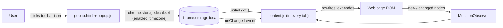
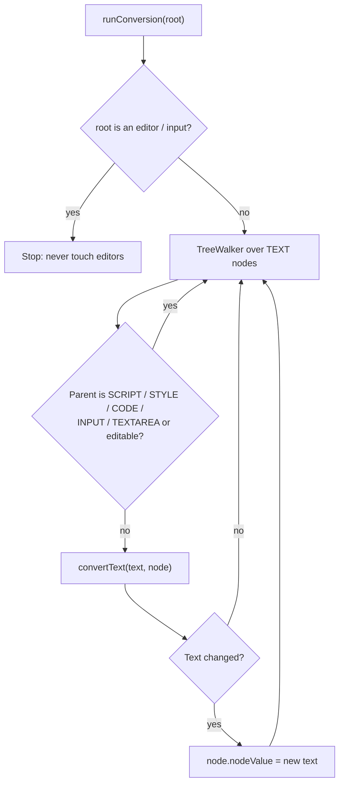
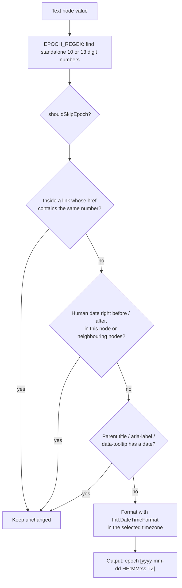
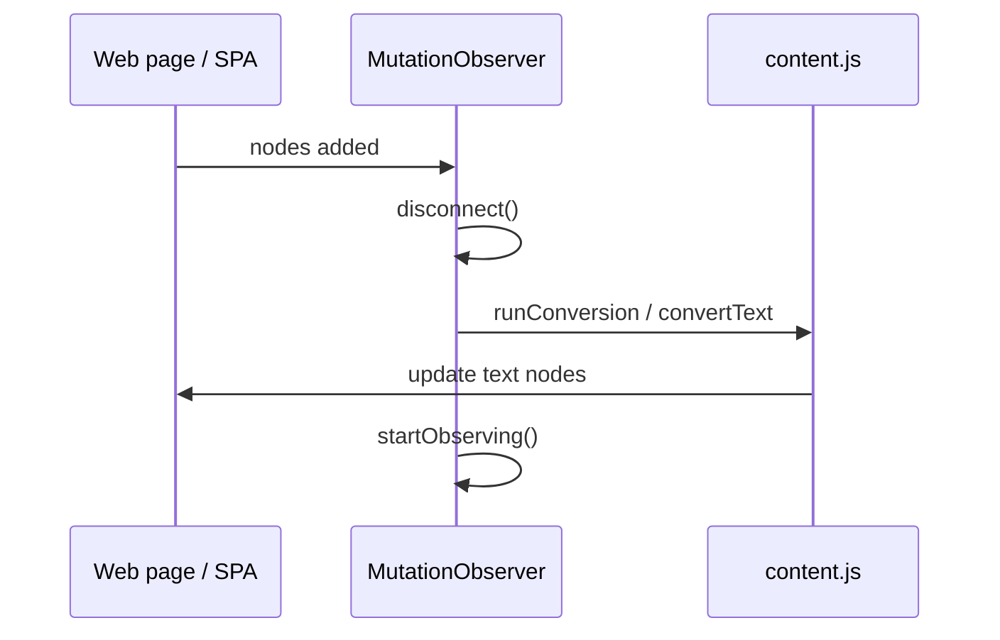
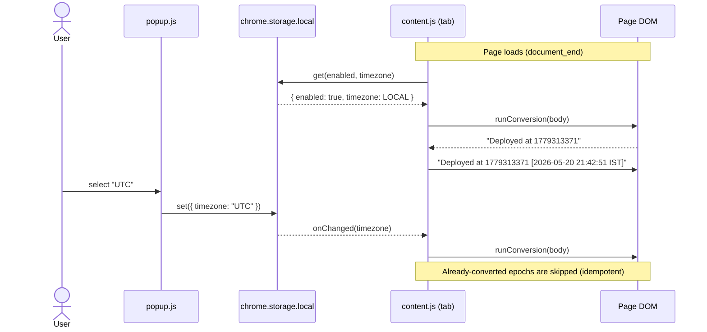

# Epoch Time Customizer

**Version:** 1.1.2 · see [Changelog](#changelog)

A Chrome extension (Manifest V3) that finds Unix epoch timestamps on any web page and shows the matching human-readable time next to them, in the timezone you pick. The popup also has two manual converters: epoch → human and human → epoch.

```
1779313371   →   1779313371 [2026-05-20 21:42:51 IST]
```

---

## Project structure

| File | Role |
| --- | --- |
| [`manifest.json`](manifest.json) | Entry point. Registers the content script, the popup and the `storage` permission. |
| [`content.js`](content.js) | Runs inside every web page. Finds epochs and adds the human-readable time. |
| [`popup.html`](popup.html) | The UI that opens when you click the toolbar icon. |
| [`popup.js`](popup.js) | Saves settings and runs the manual converters. |
| [`test_epoch.json`](test_epoch.json) | Manual test page: values that should and should not be converted. |
| `icons/` | Toolbar and store icons. |

---

## High-level architecture



The popup and the content script never message each other directly. They only share **`chrome.storage.local`**: the popup writes settings to it and every open tab reacts to the change.

---

## Workflow, step by step

### 1. Browser loads the extension: `manifest.json`

1. Chrome reads [`manifest.json`](manifest.json).
2. It registers `popup.html` as the toolbar popup (`action.default_popup`).
3. It sets `content.js` to be injected into **every URL** (`<all_urls>`) at `document_end`, i.e. once the DOM has been parsed.

### 2. A page opens: `content.js` starts

When any page finishes parsing, `content.js` runs in that tab:

1. **Default settings** are set in memory: `{ enabled: true, timezone: 'LOCAL' }`.
2. **Start watching the page:** `startObserving()` attaches a `MutationObserver` to `document.body`.
3. **Load saved settings:** `chrome.storage.local.get(...)` reads the user's settings. If the converter is enabled, it calls `runConversion(document.body)` to scan the whole page.
4. **Listen for setting changes:** `chrome.storage.onChanged` updates the settings in memory and re-scans the page when you toggle the extension or change timezone in the popup.

### 3. Scanning the page: `runConversion(rootNode)`



- Only **text nodes** are changed, by setting `nodeValue`. No HTML is ever injected, so there's no XSS risk.
- **Editors are skipped:** contenteditable areas, inputs and textareas, ARIA textboxes, and code editors (CodeMirror, Monaco, Ace, ProseMirror, Slate). Changing them would reset the user's cursor while they type.

### 4. Converting a text node: `convertText(text, node)`

For each candidate number found by `EPOCH_REGEX`:



#### 4a. Standalone-only matching (`EPOCH_REGEX`)

A number only counts as an epoch if it stands on its own:

- **Allowed before it:** start of text, whitespace, `(` `[` `{`, a quote, a comma, or a JSON key separator such as `"ts":`.
- **Allowed after it:** end of text, whitespace, `)` `]` `}`, a quote, `,` `;`, or `.` `:` `!` `?` when they are followed by whitespace or end of text.
- **Digits:** 10 digits starting with `1` or `2` (seconds), or 13 digits starting with `1` (milliseconds).

| Input | Converted? | Why |
| --- | --- | --- |
| `1779313371` | ✅ | standalone |
| `{"ts":1779313371}` | ✅ | JSON value |
| `https://site.com/orders/1779313371` | ❌ | part of a URL path |
| `?id=1779313371` | ❌ | query parameter |
| `ORD-1779313371`, `user_1779313371`, `#1779313371` | ❌ | part of an ID |
| `1779313371.jpg`, `1779313371.5` | ❌ | file name / decimal |

#### 4b. Skip checks (`shouldSkipEpoch`)

1. **`isLinkIdentifier`:** if the number is the text of an `<a>` whose `href` contains the same digits, it's treated as an ID, not a time.
2. **`hasAdjacentHumanDate`:** if a human-readable date or time already sits next to the epoch, with only separators (spaces, brackets, dashes, arrows, pipes, clock/calendar emoji) in between, it isn't converted again. Formats recognised:
   - This extension's own output: `[2026-05-20 21:42:51 IST]`, plus the older `[🕒 …]` form
   - ISO / numeric dates: `2026-07-26`, `2026-07-26T10:00:00Z`, `7/20/2026`, `20.07.2026`
   - Month names: `26 July 2026`, `26th of July`, `Jul 26, 2026`, `July 2026`
   - Weekdays: `Mon, 20 Jul 2026 16:12:51 GMT`
   - Times: `21:42`, `9:42:51 PM`
   - Relative: `3 hours ago`, `in 2 days`, `today`, `yesterday`, `just now`

   The check looks inside the current text node **and** up to 80 characters of neighbouring text nodes (`collectAdjacentText`), because other converter extensions often put their date in a separate `<span>`.
3. **`hasHumanDateAttribute`:** if the parent element's `title`, `aria-label`, `data-tooltip` or `data-original-title` already contains a date, the number is skipped.

Because of these checks the extension is **idempotent**: running it again, or copying converted text into another tab, never adds a second timestamp.

#### 4c. Formatting

`Intl.DateTimeFormat('en-US', …)` with a 24-hour clock (`hourCycle: 'h23'`) and a short timezone name produces:

```
yyyy-mm-dd HH:MM:ss TZ      e.g. 2026-05-20 21:42:51 IST
```

If the timezone is `LOCAL`, the browser's own timezone is used. Otherwise the chosen IANA zone (e.g. `America/New_York`) is passed as `timeZone`.

### 5. Keeping up with dynamic pages: `MutationObserver`

Single-page apps keep adding content after load. For each batch of mutations, the observer:

1. **Disconnects itself**, so its own text changes don't trigger it again in an endless loop.
2. Skips mutations that happened inside an editable surface.
3. For each **added element**, calls `runConversion(element)`. For each **added text node**, calls `convertText(text, node)`.
4. **Reconnects** with `startObserving()`.



### 6. The popup: `popup.html` + `popup.js`

When you click the toolbar icon:

1. **Load settings:** `chrome.storage.local.get` fills the *Enabled* checkbox and the *Timezone* dropdown.
2. **Save settings:** changing either control calls `chrome.storage.local.set(...)`. That fires `chrome.storage.onChanged` in **every open tab**, so pages update right away without a reload (step 2.4).
3. **Tabs:** *Epoch → Human* and *Human → Epoch* panels.
4. **Epoch → Human:** `formatEpochToHuman` accepts a whole number. Values under `100000000000` are treated as seconds, anything larger as milliseconds. It shows the formatted time plus ISO-8601.
5. **Human → Epoch:** reads the date and time pickers (pre-filled with "now") and converts that wall-clock time in the selected timezone to epoch seconds and milliseconds. `zonedTimeToEpochMs` / `getTimeZoneOffsetMs` handle DST with a second correction pass.
6. **Copy buttons:** a single click handler copies the result with `navigator.clipboard.writeText`.

---

## End-to-end example



> **Note:** after a timezone change, epochs that were **already** converted keep their original label, because the skip check sees the existing human date. Only newly rendered epochs, or a page reload, use the new timezone.

---

## Installing locally

1. Open `chrome://extensions`.
2. Turn on **Developer mode**.
3. Click **Load unpacked** and select this project folder.
4. Open [`test_epoch.json`](test_epoch.json) in a tab to check what is and isn't converted.

## Permissions

| Permission | Why |
| --- | --- |
| `storage` | Saves the enabled flag and timezone. |
| `content_scripts` on `<all_urls>` | Needed to find timestamps on any page. Text is only read and rewritten locally; nothing is sent anywhere. |

---

## Changelog

### 1.1.2 — Bug fix
- **Standalone epochs only:** numbers that are part of a link, URL path, query parameter, ID (`ORD-…`, `user_…`, `#…`), file name or decimal are no longer converted. Previously, a word-boundary match picked up IDs inside links and caused confusing conversions.
- **Link IDs skipped:** an epoch shown as the text of an `<a>` whose `href` contains the same number is treated as an identifier.
- **No double conversion:** an epoch that already has a human-readable date or time next to it, in any format, is left as is. That includes dates from other converter extensions such as `1779313371 (26 July 2026)`, dates in neighbouring elements, and dates in tooltip attributes.
- Added new negative cases to [`test_epoch.json`](test_epoch.json).

### 1.1.1
- Previous release.
